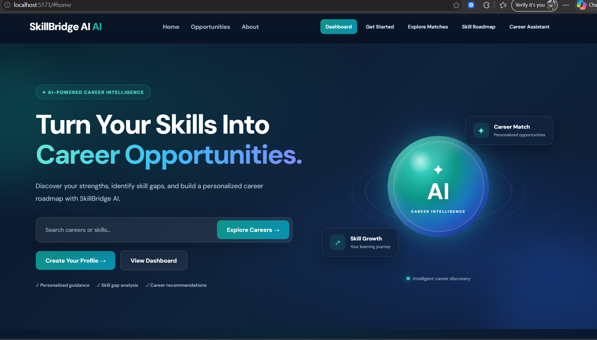
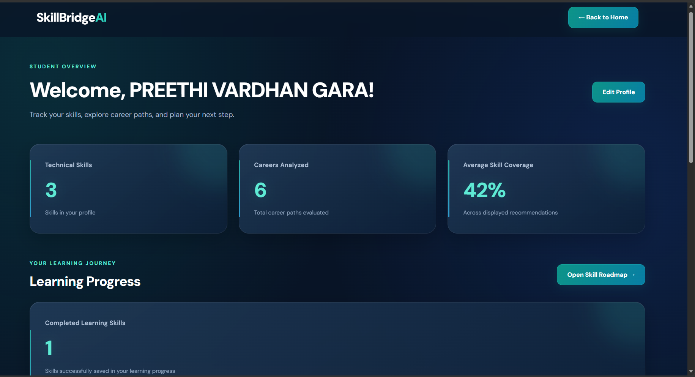
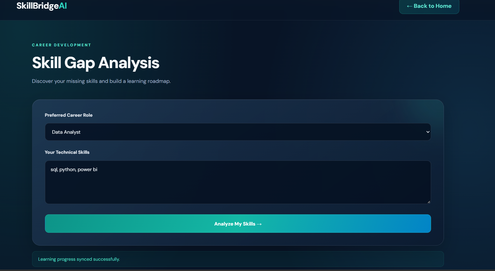
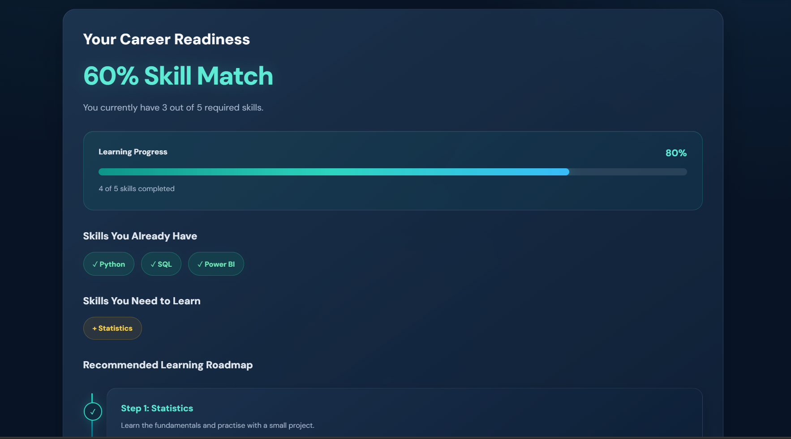
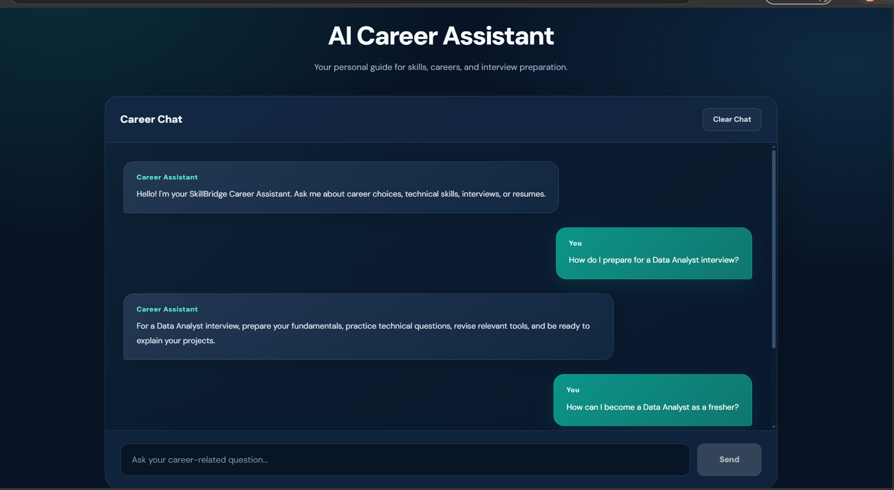

# SkillBridge AI 🚀
### AI-Powered Career Guidance and Skill Development Platform

SkillBridge AI is a career development platform designed to help students and fresh graduates identify suitable career paths, understand their skill gaps, discover relevant opportunities, and follow personalized learning roadmaps.

The platform combines an interactive React frontend with a Python FastAPI backend to provide career recommendations, skill analysis, opportunity matching, and AI-powered career assistance.

---

## ✨ Key Features

### 1. AI Career Assistant
- Interactive career-related chatbot.
- Guidance on career choices, technical skills, interviews, and resumes.
- Suggested questions for quick interaction.
- Chat history persistence using browser local storage.
- Retry option when the backend connection fails.

### 2. Career Dashboard
- Personalized career recommendations.
- Career readiness and learning progress overview.
- Completed learning skills.
- Quick navigation to important platform features.

### 3. Skill Gap Analysis
- Select a preferred career role.
- Compare existing skills with career requirements.
- Identify matched and missing skills.
- View skill match percentage.

### 4. Personalized Learning Roadmap
- Role-based technical skill requirements.
- Recommended learning resources.
- Track completed skills.
- Save and retrieve learning progress through the backend.

### 5. Opportunity Matching
- Match career opportunities against user profile information.
- Explore opportunities aligned with preferred career roles and skills.

### 6. Profile Management
- Maintain personal and career-related information.
- Store technical skills and preferred career roles.
- Retrieve and update profile information.

---

## 🛠️ Technology Stack

| Category | Technologies |
|---|---|
| Frontend | React.js, JavaScript, HTML5, CSS3 |
| Frontend Tooling | Vite, npm |
| Backend | Python, FastAPI |
| API Communication | REST APIs, JSON |
| Database | SQLite |
| Data Handling | Python, Pydantic |
| Development Tools | VS Code, Git, GitHub |

---

## 🏗️ System Architecture

SkillBridge AI follows a frontend-backend architecture.

1. **React Frontend:** Provides the user interface for profiles, dashboards, skill analysis, learning roadmaps, opportunity matching, and career assistance.
2. **FastAPI Backend:** Handles API requests, career recommendations, skill matching, profile operations, learning progress, and assistant responses.
3. **SQLite Database:** Stores profile-related and learning-progress information.
4. **Browser Local Storage:** Maintains selected client-side information, including chat history.

### Application Flow

```text
              USER
                |
                v
       REACT FRONTEND
                |
                v
         FASTAPI BACKEND
                |
        +-------+-------+
        |       |       |
        v       v       v
     Career  Profile  Learning
     Logic   Data     Progress
        |       |       |
        +-------+-------+
                |
                v
          SQLITE DATABASE
```

---

## 📂 Project Structure

```text
SkillBridge-AI/
│
├── backend/
│   ├── main.py
│   ├── database.py
│   └── venv/
│
├── public/
│
├── src/
│   ├── App.jsx
│   ├── Dashboard.jsx
│   ├── Profile.jsx
│   ├── CareerAssistant.jsx
│   ├── SkillRoadmap.jsx
│   ├── index.css
│   └── ...
│
├── index.html
├── package.json
├── package-lock.json
├── vite.config.js
├── eslint.config.js
├── .gitignore
└── README.md
```

---

## ⚙️ Installation and Setup

### Prerequisites

- Node.js and npm
- Python 3
- Git

### 1. Clone the Repository

```bash
git clone https://github.com/preethivardhan19/SkillBridge-AI.git

cd SkillBridge-AI
```

### 2. Set Up the Frontend

```bash
npm install
npm run dev
```

Open the frontend in your browser:

```text
http://localhost:5173/
```

### 3. Set Up the Backend

Open a separate terminal:

```powershell
cd backend
```

Create a virtual environment if you don't already have one:

```powershell
python -m venv venv
```

Activate it on Windows:

```powershell
.\venv\Scripts\Activate.ps1
```

Install the backend dependencies:

```powershell
pip install fastapi uvicorn pydantic
```

Start the FastAPI server:

```powershell
python -m uvicorn main:app --reload
```

Backend URL:

```text
http://127.0.0.1:8000/
```

API documentation:

```text
http://127.0.0.1:8000/docs
```

**Important:** Keep both frontend and backend terminals running while using the application.

---

## 🔌 Backend API Endpoints

| Method | Endpoint | Purpose |
|---|---|---|
| GET | `/health` | Check backend health |
| POST | `/recommend` | Generate career recommendations |
| POST | `/match` | Perform skill matching |
| POST | `/assistant` | Process career assistant questions |
| POST | `/profile` | Save profile information |
| GET | `/profile/{email}` | Retrieve profile information |
| PUT | `/progress` | Update learning progress |
| GET | `/progress/{email}` | Retrieve learning progress |

---

## 🎯 Project Objectives

- Help students understand their career readiness.
- Identify technical skill gaps based on career goals.
- Provide structured learning guidance.
- Improve access to relevant career opportunities.
- Make career preparation more organized and accessible.

---

## 📸 Screenshots


## 📸 Application Screenshots

### 1. Homepage


### 2. Career Dashboard


### 3. Skill Gap Analysis


### 4. Skill Readiness and Learning Roadmap


### 5. AI Career Assistant



---

## 🚀 Future Enhancements

- Advanced AI-powered career recommendations.
- Integration with external job and internship platforms.
- Resume analysis and improvement suggestions.
- More personalized learning recommendations.
- Advanced analytics and career progress visualization.

---

## 👩‍💻 Developer

**Gara Preethi Vardhan**

B.Tech – Computer Science and Engineering | 2026

- GitHub: https://github.com/preethivardhan19
- LinkedIn: https://linkedin.com/in/gara-preethi-vardhan-07a85028a/
- Email: preethivardhan648@gmail.com

---

## 📄 License

This project is developed for educational and portfolio purposes.
